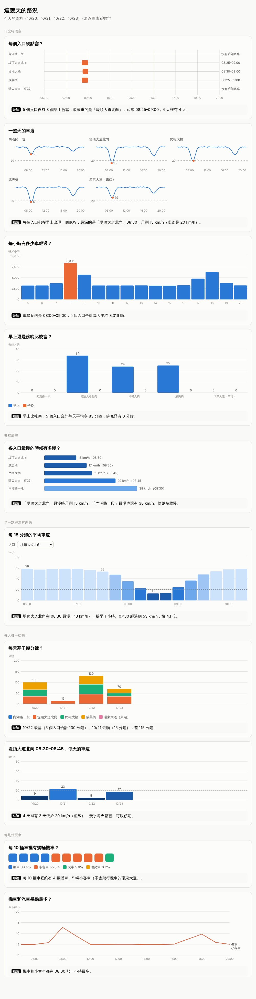
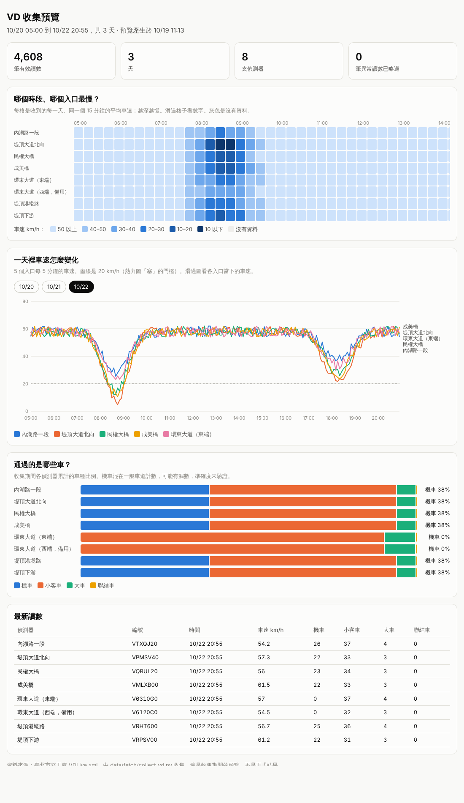

# VD 探索圖表（紀錄）

Oct 19, 2026（10/21 改版：先給尺，再看資料）· 狀態：**待看**，等收集到真實資料後再跑

找靈感用的小任務，和作品要交什麼沒有直接關係。用 10/19–10/23 收集的臺北市 VD 資料，從幾個角度看內湖入口的路況，看看有沒有新的想法。

> 這個資料夾裡的兩張截圖都是**模擬資料**畫的，只是示意圖表長什麼樣子，數字不是真的。

## 怎麼跑

在自己的電腦、專案資料夾裡（收集程式要先跑過）：

```
cd ~/Desktop/taipei-hackathon-2026 && git pull && python3 data/processed/explore_vd.py && open data/raw/explore.html
```

- 產生的 `data/raw/explore.html` 含真實資料，不會進 git。
- 至少要有一個完整的早上（10/20 中午後）才看得出東西；比較每天的圖要 2 天以上。
- 另外有一頁比較原始的預覽：`python3 data/processed/preview_vd.py && open data/raw/preview.html`（熱力圖、各入口車速折線、車種比例、最新讀數）。

## 先看尺：怎麼判斷塞不塞

只數「低於 20 km/h 幾分鐘」會把所有資訊壓成「過線／沒過線」：沒過線的全部變成 0，看不出慢了多少。這一頁改成先給一把尺，再看每個入口落在哪裡。

用服務水準 A–F 分級（A 最順、F 最塞），**E、F 級算「塞」**。兩把尺：

| 尺 | A | B | C | D | E | F | 出處 |
| --- | --- | --- | --- | --- | --- | --- | --- |
| 跟平常比：車速是平常的幾 % | 85% 以上 | 67–85% | 50–67% | 40–50% | 30–40% | 30% 以下 | HCM（美國公路容量手冊）市區道路服務水準 |
| 依速限：速限 50 的市區道路（km/h） | 35 以上 | 30–35 | 25–30 | 20–25 | 15–20 | 15 以下 | 《臺灣公路容量手冊》（交通部運輸研究所，2011 年版），經臺中市交通量調查報告轉引 |

- 兩把尺的 E 級上限都是基準的 40%，所以頁面上的**塞車線＝平常車速的 40%**。
- **平常車速**＝車少時（車輛數不超過中位數的讀數）的第 85 百分位，參考維吉尼亞州交通研究的做法（車少時段的第 85 百分位）。
- 各入口速限暫定 50（臺北市市區道路的法定速限），待對照[速限表](https://data.gov.tw/dataset/121671)；環東大道是快速道路，「依速限」那把尺不適用。
- 兩個標準原本用在**整段路的旅行速率**；偵測器量的是**單點車速**，路段中間的偵測器量到的會比旅行速率快，等級可能偏樂觀。
- 手冊數字要再對照 2022 年版原文（[THCS 下載專區](https://thcs.iot.gov.tw/WebForm3.aspx)第 16 章「市區幹道」），也可以比對臺北市交工處的「[路況壅塞水準定義](https://data.gov.tw/dataset/135698)」。



每張圖只回答一個問題，圖下的「結論」是程式從資料自動算出來的一句話。

### 手上有哪些資料

| # | 圖 | 怎麼看 | 結論會寫什麼 |
| --- | --- | --- | --- |
| V | 每天收到哪些時段 | 一天一列、一小時一格，顏色越深收得越完整 | 早上 07:00–10:30、傍晚 17:00–19:00 各有幾天收完整；沒有離峰資料時提醒「平常車速」可能偏低 |

收集不是每天都完整也沒關係：晨峰的分析只需要平日 07:00–10:30。會受影響的地方已經處理：每小時的車數除以「那個小時有資料的天數」；每天的比較只看 07:00–10:30，而且只比收完整的天；「剩平常的幾 %」需要一些離峰的讀數，補收一個晚上就夠。

### 先看尺

| # | 圖 | 怎麼看 | 結論會寫什麼 |
| --- | --- | --- | --- |
| R | 最慢的時候，剩平常車速的幾 % | 所有入口放在同一把尺上（底色是 A–F）。實心圈是早上／傍晚最慢的 1 小時（各天的中位數），空心圈是最慢的那一天 | 早上最慢的入口剩幾 %、幾個入口落到 E 級以下；傍晚呢 |

### 什麼時候塞

| # | 圖 | 怎麼看 | 結論會寫什麼 |
| --- | --- | --- | --- |
| 1 | 一天裡每個入口在哪一級 | 每 15 分鐘一格，顏色是 A–F（各天的中位數）；可以切換兩把尺，滑過格子看每天的車速與「幾天裡有幾天在 E 級以下」。15 分鐘不到 15 輛車的格子只畫外框、不判斷等級：清晨車很少，幾台車剛好停紅燈車速就會很低 | 早上落到 E 級以下的入口與時段 |
| Z | 放大看：某一天、每 5 分鐘 | 選入口和日期，上到下是車速、各車種車輛數、佔有率（偵測器被車壓住的時間 %）。5 分鐘是資料來源最細的統計 | 從幾點開始連續低於塞車線；開始前 30 分鐘車有沒有變多、佔有率怎麼變。車變多＝車流湧進來；車沒變多車速卻掉＝比較像下游塞回來 |
| 2 | 一整天的車速 | 每個入口一張小圖，同樣的刻度；橘點是最低點，虛線是塞車線 | 最深的低谷在哪個入口、幾點、剩多少 km/h |
| 3 | 每小時有多少車 | 5 個入口合計、每天平均（只除以那個小時有資料的天數）；橘色是最多的那一小時 | 車最多的是幾點到幾點、每小時幾輛 |

### 哪裡最塞

| # | 圖 | 怎麼看 | 結論會寫什麼 |
| --- | --- | --- | --- |
| 5 | 各入口最慢有多慢 | 橫條排行，條越短越慢，旁邊寫最慢的時間 | 最慢和最快的入口各剩多少 km/h |

### 車多，還是塞住了？

| # | 圖 | 怎麼看 | 結論會寫什麼 |
| --- | --- | --- | --- |
| 11 | 車速和流量放在一起看 | 每個點是一筆 5 分鐘讀數，可以切換入口。右上是車多但還順；車速往下掉、點又往左縮，就是排隊塞住了 | 每小時最多通過幾輛汽車；低於塞車線時通過的車有沒有變少（變少＝真的塞住，沒變少＝只是車多） |

### 早一點經過有差嗎

| # | 圖 | 怎麼看 | 結論會寫什麼 |
| --- | --- | --- | --- |
| 6 | 每 15 分鐘的平均車速 | 06:00–10:30 每 15 分鐘一根，可以切換入口；虛線是該入口的塞車線 | 最慢在幾點、提早 1 小時經過快幾倍 |

### 每天都一樣嗎

| # | 圖 | 怎麼看 | 結論會寫什麼 |
| --- | --- | --- | --- |
| 7 | 每天早上塞了幾分鐘 | 只算 07:00–10:30，一天一根，各入口疊起來；那段沒收完整的天顏色變淡、日期加 * | 收完整的天裡，哪天最塞、哪天最順、差幾分鐘 |
| 8 | 最塞的 15 分鐘，每天的車速 | 最塞入口的最塞時段，一天一根 | 幾天裡有幾天低於塞車線，能不能預期 |

### 都是什麼車

| # | 圖 | 怎麼看 | 結論會寫什麼 |
| --- | --- | --- | --- |
| 9 | 每 10 輛車 | 10 個方塊，顏色是車種 | 每 10 輛裡有幾輛機車、幾輛小客車 |
| 10 | 機車和汽車幾點最多 | 兩條線：各小時佔全天的比例 | 機車和小客車的高峰各在幾點、機車是不是比較早出門 |

## 看的時候可以想的問題

- 兩把尺看到的一樣嗎？不一樣的入口（例如偵測器緊鄰路口的），速限那把尺會比較嚴。
- 塞車時段每天固定嗎？固定的話，錯峰建議比較有把握。
- 最先開始塞的是哪個入口？那裡可能是瓶頸。
- 傍晚也塞嗎？如果比早上輕很多，代表上班時間比下班時間集中。
- 同一個時段有時順、有時塞嗎（圖 8）？開車的人怕的通常是「不知道今天會不會特別慢」。
- 機車是不是比汽車早出門？尖峰時大車多不多？

## 要注意

- 機車混在一般車道計數，可能有漏數；環東大道禁行機車，圖 9、10 不含它。
- 民權大橋、成美橋的偵測器在引道上，不在橋上（見 `data/processed/README.md`）。
- 資料只有 10/19 晚上到 10/23（4 個完整的早上），結論是「這幾天看到的」，不是長期規律。

## 相關檔案

- 程式：`data/processed/explore_vd.py`、`data/processed/preview_vd.py`
- 收集：`data/fetch/collect_vd.py`（輸出在 `data/raw/`，不進 git）

預覽頁示意（模擬資料）：


